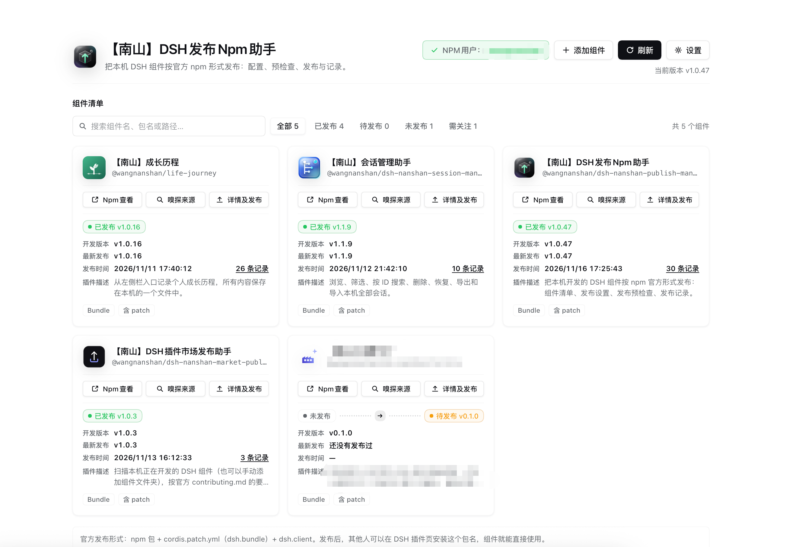
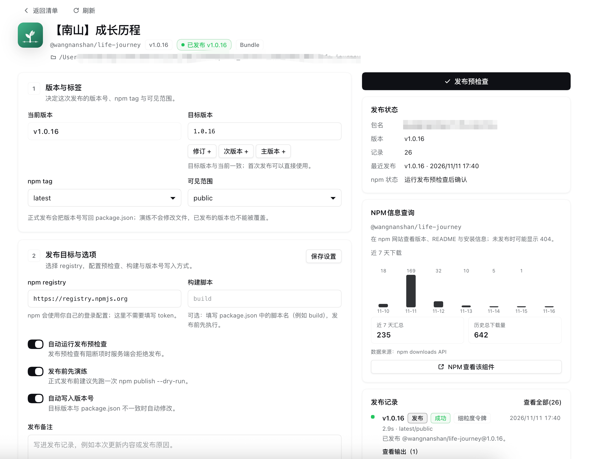
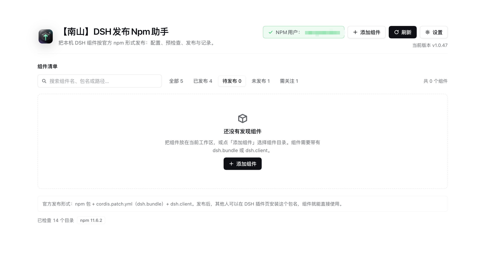

# 【南山】DSH发布Npm助手

把本机开发的 DSH 组件，按 DeepSeek Harness 官方推荐的 npm 包形式发布给其他人安装。

- **一个组件清单页**：卡片形式展示本机所有可发布的 DSH 组件（`dsh.bundle` / `dsh.client`），包含版本、发布状态、预检查结果和最近一次发布；卡片底部提供「查看详情」「Npm查看」「查看来源」三个按钮。
- **一个组件详情页**：点击卡片底部的「查看详情」进入，用「流程化板块」完成发布——版本与标签 → 发布目标与选项 → 发布预检查 → 确认与执行，右侧常驻该组件的 **NPM信息查询**、**发布记录列表**。

「查看来源」会展示组件是通过 profile link 依赖、手动添加的目标目录，还是目录扫描被发现；来源中的 package.json 等文件可以定位到系统文件管理器。如果组件目录已删除但仍被来源记录引用，卡片会以「残留」状态显示，弹窗会说明原因以及清理方式。

界面采用现代极简的开发者工具控制台风格（Linear / Vercel / Raycast 一类的浅色克制审美），跟随 Harness 的浅色 / 深色主题。插件图标、侧栏入口和页面标识使用 3D 液态玻璃黑色调；搜索、勾选、关闭等功能图标保持线性，以保证小尺寸下的可读性。

---

## 界面截图

### 组件清单



卡片展示本机所有可发布的 DSH 组件，支持搜索与按发布状态筛选；每张卡片包含图标、包名、操作按钮、发布状态（已发布 → 待发布）、开发版本 / 最新发布 / 发布时间，以及类型标签。

### 组件详情与发布



左侧为「版本与标签」「发布目标与选项」配置，右侧常驻「发布预检查」「NPM 信息查询（近 7 天下载与历史总下载）」「发布记录」。

### 空状态



未发现组件时的引导界面。

---

## 官方发布形式

DSH 组件就是一个 npm 包：

```jsonc
{
  "name": "@your-scope/your-plugin",
  "version": "1.0.0",
  "type": "module",
  "exports": {
    ".": "./index.js",
    "./client": "./client.js",          // 有 UI 时
    "./locale/*.json": "./locale/*.json",
    "./icon": "./icon.svg"
  },
  "files": ["index.js", "client.js", "cordis.patch.yml", "locale/*.json", "icon.svg", "README.md"],
  "dsh": {
    "bundle": { "patch": "./cordis.patch.yml" },
    "client": {
      "platform": "web",
      "immediately": true,
      "inject": ["@deepseek-ai/dsh-client-locale", "@deepseek-ai/dsh-client-ui-layout", "@deepseek-ai/dsh-client-ui-sidebar"]
    }
  }
}
```

`cordis.patch.yml` 插入插件行：

```yaml
- insert:
    - id: your-plugin
      name: '@your-scope/your-plugin'
```

发布到 npm 之后，其他人在 DSH 的插件页安装这个包名即可使用。本插件就是按这套形式检查、打包和发布的。

## 发布预检查

静态预检查（进入详情页立即显示）：

| 预检查项 | 说明 |
| --- | --- |
| package.json 可读 | 组件目录必须有可解析的包清单 |
| 包名符合 npm 规范 | 小写字母、数字与 `- . _ ~`，作用域包为 `@scope/name` |
| 版本号符合语义化版本 | 如 `1.2.3`、`1.3.0-beta.1` |
| 未标记 private | `"private": true` 的包无法发布 |
| 包含描述 / 许可证 | 影响 npm 与插件页展示 |
| 使用可发布的作用域 | `@local/...` 只是本地占位，发布会提示 |
| bundle patch 文件存在 | `dsh.bundle.patch` 指向的 `cordis.patch.yml` 必须存在 |
| patch 的 name 与包名一致 | 官方形式要求 insert 行的 `name` 等于包名 |
| dsh.client 入口存在 | 声明了 `dsh.client` 就要有 `client.js` |
| 导出 locale / 图标 | `exports` 中的 `./locale/*.json` 与 `./icon` |
| files 覆盖运行文件 | `files` 必须覆盖 index / client / patch / 图标 |
| 图标有效 | SVG / PNG / JPEG / WebP，且不超过 256 KiB |
| locale 包含标题与描述 | 读取 `meta.title` / `meta.description`（兼容顶层 title） |
| 包含 README | 说明安装与使用方式 |

完整预检查（点击「发布预检查」）还会执行：

| 预检查项 | 说明 |
| --- | --- |
| 找到 npm | 自动从 PATH、Homebrew、nvm、Volta 等位置查找 |
| 已登录 npm registry | 运行 `npm whoami`；演练时只提示不阻断 |
| registry 可访问 | `npm view <name> versions dist-tags --json`，首次发布 404 视为正常 |
| 目标版本未被占用 | 已发布版本不能被覆盖 |
| 版本高于已发布版本 | 低于最新版只提示 |
| npm 打包内容完整 | `npm pack --dry-run --json`，逐个确认运行文件与资源会进入包 |
| 构建脚本存在 | 配置了构建脚本时检查 `scripts` 中是否存在 |

## 发布流程

1. **版本与标签** —— 目标版本（写回 `package.json`）、npm tag、`public` / `restricted`。
2. **发布目标与选项** —— registry（默认读取你的 `~/.npmrc`）、可选构建脚本（`npm run <script>`）、自动运行发布预检查、先演练、自动写入版本号、发布备注。
3. **发布预检查** —— 运行发布预检查；有阻断项时正式发布按钮不可用。
4. **确认与执行** —— 选择发布验证方式，勾选确认，先「仅演练」（`npm publish --dry-run`，临时写入的目标版本会在演练后还原）或「正式发布」（带最终确认弹窗）；本机会话方式的最终弹窗按钮为：左侧「再想想」，右侧「采用终端发布（推荐）」和「采用 OTP 发布」。
5. **发布记录** —— 每次演练 / 发布 / 失败都会写入本机记录，包含版本、tag、access、验证方式、耗时、预检查摘要和命令输出；终端发布会在记录里标记「终端」。
6. **NPM信息查询** —— 右侧栏显示当前包名、近 7 天每日下载量柱状图（数据来自 npm downloads API）和「NPM查看该组件」入口。

## 发布验证方式

npm 已在 **2025-12-09 永久撤销全部经典 Token**，本插件不再提供该选项，只支持当前仍在使用的三种方式：

| 方式 | 适用场景 | 凭据处理 |
| --- | --- | --- |
| **本机登录会话 + OTP**（默认） | 本机交互发布；`npm login` 生成 2 小时会话，发布时 npm 强制 2FA | OTP 通过 `npm_config_otp` 环境变量交给 npm，不写命令、不落盘 |
| **Granular Access Token** | 无人值守、CI 之外的自动化；可在 npm 设置中开启 **Bypass 2FA** | 令牌只用于本次发布，写入权限为 `0600` 的临时 npmrc，发布结束立即删除；不保存、不写日志 |
| **OIDC 可信发布** | 仅 GitHub Actions（`id-token: write`）或 GitLab CI（`NPM_ID_TOKEN`） | npm 自己用 CI 的 ID Token 换取短期发布令牌，插件不接触任何长期凭据 |

本地 DSH 中 OIDC 选项会显示为不可用；在支持的 CI 环境里会自动变为可用。注意：OIDC 还需要在 npm 包的设置里配置对应的 Trusted Publisher。

Granular Access Token 可以在 npm 网站 Settings → Tokens 或 `npm token create` 创建；写令牌最长 90 天，无人值守发布建议开启 Bypass 2FA。

页面内的 OTP 只支持 TOTP（身份验证器 6 位数字）。如果账号使用安全密钥 / 网页型 2FA，npm 需要在交互式终端里打开浏览器授权；这种情况下可以直接在确认弹窗点「采用终端发布（推荐）」，或创建一个开启 Bypass 2FA 的 Granular Access Token 后使用「细粒度令牌」方式。

npm 凭据**不经过插件的存储层**：本机会话使用你自己的 `~/.npmrc`；Granular Token 的临时 npmrc 在发布后删除；OTP 只作用于一次子进程。三者都不会写入发布记录。

### 在系统终端发布

在「本机登录会话」方式下，最终确认弹窗提供「采用终端发布（推荐）」：

- macOS 打开 Terminal.app；
- Windows 打开 `cmd.exe`；
- Linux 尝试 `x-terminal-emulator`、`gnome-terminal`、`konsole`、`xfce4-terminal`、`xterm`。

插件会生成一个临时脚本并自动执行实际发布命令（配置了构建脚本时先执行构建）。你在系统终端里完成 OTP 或浏览器/安全密钥验证；插件等待最多 15 分钟，读取退出码后把结果写入发布记录，记录带「终端」标记。终端输出保留在系统终端窗口，不写入插件记录，避免 OTP 进入日志。

如果终端没有自动出现，或等待超时，插件会弹出居中的错误弹窗；终端窗口里的完整输出仍然保留，可据此排查。

### OTP 的时机

OTP 不是插件强制每次都要填写的字段：

- **本机会话**：当 npm 对你的账号或这个包要求发布 2FA 时，每一次发布尝试都会发起挑战。填写后才随请求发送；不填时若 npm 挑战，会返回 EOTP，并弹出居中的错误弹窗、清空旧码；关闭弹窗后重新点「正式发布」即可重试。验证码一次性、约 30 秒有效，不能复用。
- **填写时机**：OTP 只在点击「正式发布」后的确认弹窗里填写。UI 已经运行过发布预检查时，服务端不会在点击后再次执行整套 npm 预检查，因此验证码会在确认后的极短时间内使用，避免被前置预检查拖到过期。
- **Granular Access Token**：令牌开启 **Bypass 2FA** 时不需要 OTP；未开启时 npm 仍会挑战，建议改用本机会话 + OTP 或换一个开启 Bypass 2FA 的令牌。
- **OIDC 可信发布**：由 CI 的 ID Token 换发短期令牌，不需要 OTP。
- **仅演练**：不访问 registry，不需要 OTP。

### 发布命令如何组织

实际执行的命令按场景生成，日志里的命令就是真实 argv，并在末尾用注释标出凭据来源：

| 场景 | 命令 |
| --- | --- |
| 有作用域包（`@scope/name`） | `npm publish --tag <tag> --access <public\|restricted> --registry <registry>` |
| 无作用域包 | `npm publish --tag <tag> --registry <registry>`（无作用域包只能是 public，省略 `--access`） |
| 本机会话 + OTP | 同上，OTP 通过 `npm_config_otp` 环境变量传递，日志注 `# auth: local session + OTP (npm_config_otp)` |
| 细粒度令牌 | 同上，令牌通过一次性 npmrc（`npm_config_userconfig`）传递，日志注 `# auth: granular access token (temporary npmrc)` |
| OIDC | 同上，npm 自动完成 OIDC 交换，日志注 `# auth: OIDC trusted publishing` |
| 在系统终端发布 | 同上，在系统终端里交互完成 OTP / 网页 2FA，日志注 `# auth: local session (system terminal)` |
| 仅演练 | 追加 `--dry-run`，不注认证信息 |

预发布版本（如 `1.0.0-beta.1`）选择 `latest` 时会给出警告，建议改用 `beta` / `next`；目标版本低于已发布最新版时，npm 会拒绝把 `latest` 指回旧版本，插件会把该错误翻译成明确的提示。

### 如果 OTP 一直失败

按顺序排查：

1. 确认验证码来自**当前登录账号**（`npm whoami` 显示 `wangnanshan`）绑定的身份验证器，并且是刚生成的；旧码不能复用。
2. 确认系统时间自动同步。TOTP 依赖本机时钟；当前机器与 npm registry 的偏差约 0.6 秒，属于正常范围。
3. 如果账号的 2FA 方式是**安全密钥 / 网页认证**而不是身份验证器 TOTP，页面内输入 6 位码不会成功。请在确认弹窗点「采用终端发布（推荐）」，让 npm 在系统终端里打开浏览器授权；或使用下面的令牌方案。
4. 使用 **Granular Access Token** 时，必须在创建令牌时勾选 **Bypass 2FA**（`npm token create --bypass-2fa`）；只粘贴一个未开启 Bypass 2FA 的令牌仍会返回 EOTP。
5. 如果配置了构建脚本，构建会先于发布执行；构建较慢时验证码可能过期，建议使用开启 Bypass 2FA 的令牌。

失败信息现在会附带「到达发布执行时验证码已输入多少秒」：超过 25 秒更可能是过期；如果只有几秒仍被拒绝，则更可能是验证码不属于当前账号、验证码输错，或账号使用的是安全密钥 / 网页型 2FA 而不是 TOTP。

## 安装

在 Harness 的插件页安装这个 bundle 目录（推荐使用 Harness 的安装入口），安装后左侧栏会出现「【南山】DSH发布Npm助手」图标。

开发时也可以在 profile 里链接：

```jsonc
// ~/.dsh/profiles/<profile>/package.json
{
  "dependencies": {
    "@wangnanshan/dsh-nanshan-publish-manager": "link:/path/to/nanshan-publish-manager"
  },
  "dsh": { "profile": { "bundles": ["@wangnanshan/dsh-nanshan-publish-manager"] } }
}
```

## 配置

在 profile 的 `cordis.patch.yml` 中该插件的 `config` 里设置：

```yaml
- insert:
    - id: nanshan-publish-manager
      name: '@wangnanshan/dsh-nanshan-publish-manager'
      config:
        scanRoots: []          # 额外扫描的组件目录（绝对路径或 ~/...）
        maxScanDepth: 2        # 扫描深度 1–3
        allowPublish: true     # false 时禁止正式发布，只能演练
        publishTimeoutMs: 180000
        # registry: https://registry.npmjs.org   # 覆盖默认 registry
```

组件发现顺序：

1. 当前 profile 中 `link:` / `file:` 依赖指向的本地包；
2. `scanRoots` 指定目录（按 `maxScanDepth` 递归）；
3. 当前工作区（DSH 的当前工作目录，最多两层）；
4. 在页面上用「添加组件」手动选择的目录（持久保存）。

只收录带 `dsh.bundle` 或 `dsh.client` 的包。

## 数据与接口

数据文件：`$DSH_HOME/nanshan-publish-manager/publish-state.json`

- 组件发布设置（按目录保存）
- 发布记录（每个组件最多 120 条）
- 手动添加的组件目录

HTTP 接口（仅本机、同源写入）：

| 方法 | 路径 | 作用 |
| --- | --- | --- |
| GET | `/api/nanshan-publish-manager` | 组件清单、npm 状态、扫描信息；`?refresh=1` 跳过缓存 |
| GET | `/api/nanshan-publish-manager/component?dir=` | 组件详情、静态预检查、设置、发布记录 |
| POST | `/api/nanshan-publish-manager/check` | 运行发布预检查（含 npm 命令） |
| POST | `/api/nanshan-publish-manager/settings` | 保存发布设置 |
| POST | `/api/nanshan-publish-manager/targets` | 添加组件目录 |
| POST | `/api/nanshan-publish-manager/publish` | 演练或正式发布；body 可带 `authMode`（`session` / `token` / `oidc`）与 `accessToken`（仅 token 模式，不落盘） |

接口只接受 loopback 请求；写操作校验同源；组件目录必须是带 `dsh.bundle` / `dsh.client` 的包，避免把任意目录交给 npm。

## 已知限制

- 需要本机安装 Node.js 与 npm（版本检查会显示 npm 版本，找不到时页面顶部提示）。
- 正式发布需要先 `npm login`（2 小时会话，默认网页授权）；未登录时只能演练。
- Granular Access Token 若未开启 Bypass 2FA，发布时仍会被要求 OTP；此时请改用本机会话 + OTP。
- 发布使用本机 npm 配置，不支持在页面里输入 token；OTP 只用于单次发布，不落盘。
- 系统终端发布支持 macOS Terminal、Windows `cmd.exe` 和 Linux 常见终端；Windows 的 `npm.cmd` 已做启动适配，但当前环境主要在 macOS 验证。
- 终端发布最多等待 15 分钟；关闭终端或未完成验证会超时，不会写入成功记录；终端输出不写入插件记录。
- 近 7 天下载量来自 npm downloads API，统计通常滞后约 1 天；新包或未发布包可能暂无数据。
- 页面直接执行 `npm publish`，请在发布前用「仅演练」确认打包内容。
- `npm publish` 会执行组件 `package.json` 中的 publish 生命周期脚本；请只发布你信任的组件。
